# underwriting-agent-demo

Reads a multifamily or build-for-rent deal's raw documents (offering memorandum, T-12 statement, rent roll) and writes underwriting workbooks, HTML previews and a model-ready field manifest, with every number traced to its source.

**Live:** [hermanchan.ai/demo/underwriting](https://www.hermanchan.ai/demo/underwriting/)

## Why it exists

Underwriting a rental deal starts with re-keying three broker documents into a model: a trailing-twelve-month P&L in whatever chart of accounts the seller's accounting system uses, a rent roll in whatever layout the property-management software exports, and a marketing PDF. Every shop already has a financial model. The slow, error-prone part is filling it: mapping every account line onto a standard category list, separating new-lease rents from renewals, and noticing when the statement's own totals do not add up. This repository does that extraction and shows its work.

## Architecture

```mermaid
flowchart LR
    subgraph inputs[Raw documents]
        OM[Offering memorandum<br/>PDF / DOCX]
        T12[T-12 statement<br/>XLSX / XLS / CSV]
        RR[Rent roll<br/>XLSX / XLS / CSV]
    end
    inputs --> intake[intake.py<br/>size + type gate]
    intake --> parse[parse_worker.py<br/>sandboxed subprocess]
    parse --> classify[classify.py<br/>which file is which]
    classify --> extract[extract_llm.py<br/>fields with verbatim quotes,<br/>line-to-category mapping,<br/>column profile]
    mock[mock mode:<br/>deterministic rules, $0] -.-> extract
    classify --> readers[source_readers.py<br/>numbers read from cells]
    extract --> assemble[assemble.py]
    readers --> assemble
    assemble --> json[(deal-outputs.json<br/>validated by schema.py)]
    json --> policy[policy.py<br/>public vs internal]
    policy --> writers[write_*.py<br/>5 workbooks, formulas live]
    policy --> previews[render_previews.py<br/>14 HTML fragments]
    writers --> scrub[scrub_check.py<br/>publishing gate]
    previews --> scrub
```



The model is asked for mappings and fields, never for numbers. It says which column is the unit id and which account line is "Payroll"; `tools/source_readers.py` then reads the values out of the cells. Every memorandum field must arrive with a quote that appears verbatim in the extracted text, or it is dropped.

## Quickstart

Runs offline on the bundled synthetic deal, with the model in mock mode (no API key, no spend):

```bash
python3 -m venv .venv && .venv/bin/pip install -r requirements-dev.txt
.venv/bin/python -m server.pipeline sample/inputs --out out --price-per-unit 215000
.venv/bin/pytest --disable-socket
```

The second command writes `out/deal-outputs.json`, five workbooks and `out/previews/`. The committed copy of that run is in `sample/outputs/`. The sample is "Wildflower Crossing", an invented 24-home build-for-rent community at an invented address; its documents are generated by `sample/make_sample.py`, and on it the pipeline reads a T-12 net operating income of $320,598 against an illustrative $215,000 per home.

Live mode (`DEMO_MODEL_MODE=live`, `ANTHROPIC_API_KEY` in `.env`, `pip install anthropic==1.3.0`) sends the same calls to the model. Nothing in the test suite uses it.

## How it's tested

- **33 check scripts**, each printing named PASS/FAIL lines, run by `tests/test_suites.py` under pytest. Each runs in its own interpreter with network sockets disabled, so a suite that reached for the network would fail.
- **The chain contract** (`contract/test_chain_contract.py`) runs the real pipeline on the sample and checks every reader against the source's own printed totals: the interchange JSON, each workbook with its formulas evaluated by a small strict evaluator (`contract/xl_eval.py`; the writers leave arithmetic to Excel, so a saved file has no cached values), and the HTML previews. Its red leg changes one month of one revenue line under an unchanged printed total and asserts that the workbook's own error check reads REVIEW. Building the contract found a defect in the synthetic rent roll (a printed square-footage total that did not match its unit rows); the generator now computes it.
- **Parser and gate tests** throw hostile inputs at intake: a macro workbook named `.xlsx`, a zip bomb (refused from the central directory without decompressing), an encrypted PDF, a PDF over the page cap.
- **Writer and schema tests** run on `tools/fixtures/synthetic_full.json`, a deterministic synthetic deal built to hit edge cases: no printed Gross Scheduled Rent line, a plan with zero new leases, a lease start that reads `n/a`, a missing source subtotal.
- Every fixture is generated by a script in the repo (`server/tests/fixtures/make_fixtures.py`, `tools/fixtures/make_fixture.py`, `sample/make_sample.py`). CI runs ruff and the suite on Python 3.11 and 3.12.

## Design decisions

- **The model maps; code reads numbers.** A mislabelled column produces a visibly wrong row. A model re-typing a rent produces a plausible wrong one. The cost is a deterministic reader per layout family, plus a mock mode that has to reach the same mapping by rules.
- **Formulas in the workbook, a Python mirror for everything else.** The P&L is `SUMIF`s over the data tab so a reviewer can audit it in Excel; `tools/compute.py` mirrors each formula for the previews and tests. Two implementations can drift, which is why the chain contract evaluates the saved formulas instead of trusting the mirror.
- **Absent with a reason, never a plausible fill.** An unknown value reads `MISSING`; an empty block (comps, demand, supply, trade-out) must carry an `absent_reason` or the schema rejects it. The offline sample's market tabs are empty for exactly this reason, and say so.
- **Tie to the statement's own subtotals.** A T-12 read that misses the statement's printed totals by more than $1 is flagged REVIEW line by line, and one that misses by more than a small band is withheld rather than published with the wrong NOI.
- **New move-in rent, not a blended "recent lease" rent, feeds the model.** A blend of new leases and renewals understates loss-to-lease on every deal it touches, so renewals are shown as context and kept out of the market-rent column.

## What's not in this repo and why

- **The live demo's sample deal.** The live site runs a different sample deal, which is not included here. This repository's sample is invented end to end.
- **The market-report service.** On the hosted demo, rent comps come from the author's own weekly rent scrape, demand rings from public Census/BLS data, and competing supply from a permit pipeline. That service, its database and its client are separate systems; offline, those three blocks are written absent with the reason.
- **Licensed and vendor data.** No third-party comp feed, subscription market data, or vendor-derived property attributes are used or shipped.
- **The hosted service layer.** The HTTP API, upload limits, spend ledger, bot check and deployment configuration are not included. `server/pipeline.py` runs the same stages from the command line.

---

© 2026 Herman Chan. Published for portfolio review; no license is granted.
